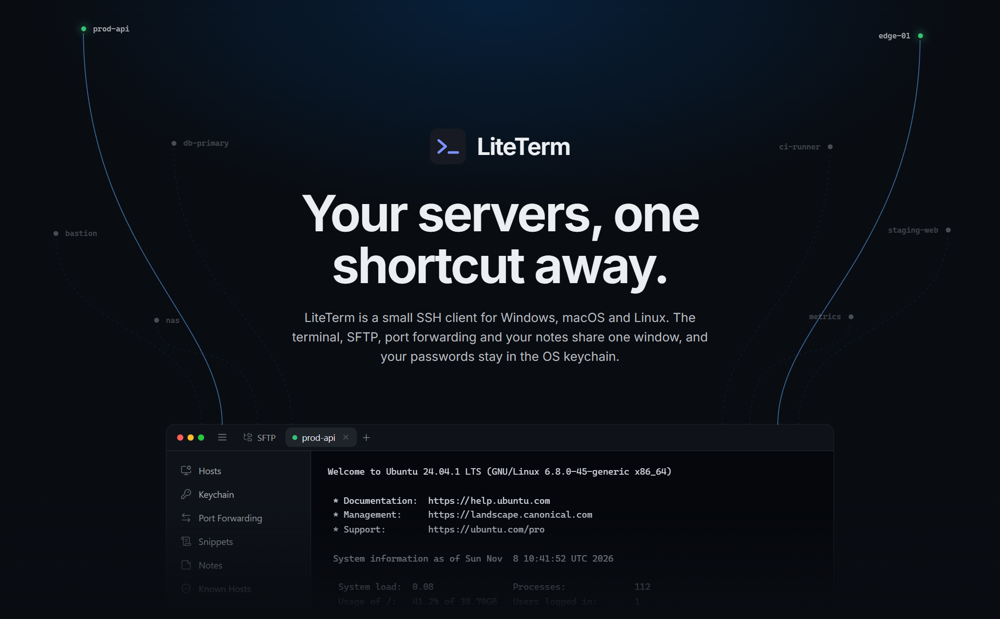
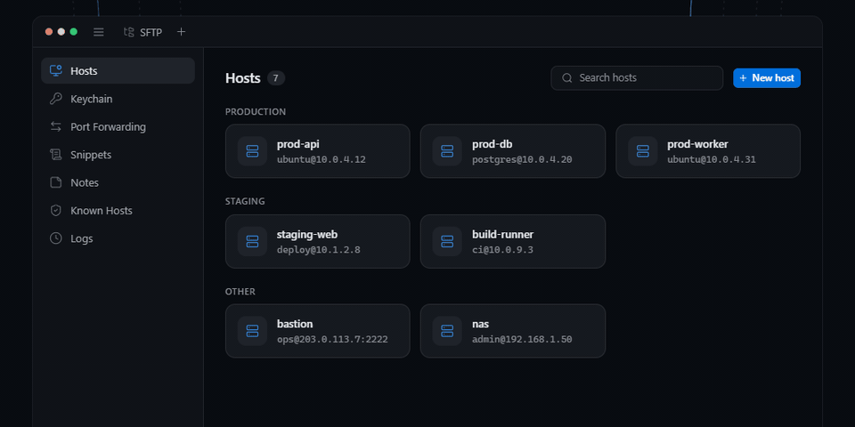
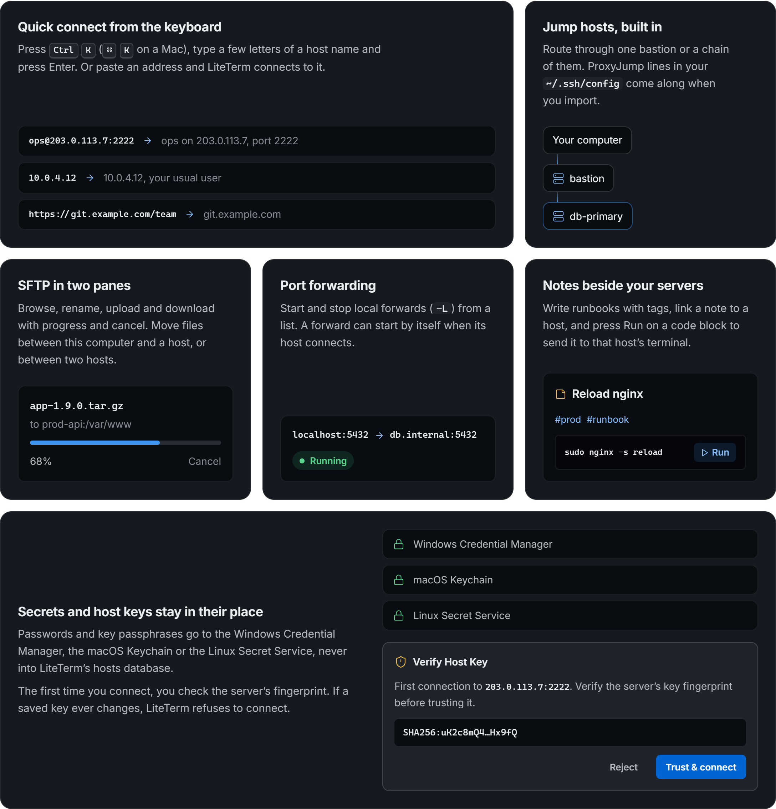
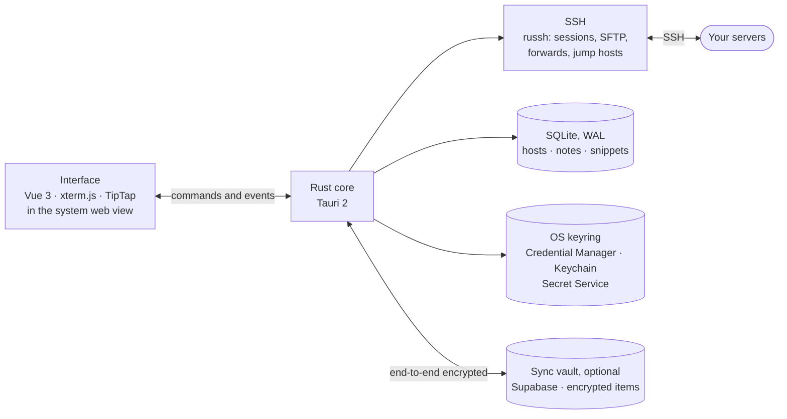

<div align="center">



<br><br>

[](https://github.com/adittanu/liteterm/releases/latest)

<br>


### [Download](https://github.com/adittanu/liteterm/releases/latest) · [Website](https://adittanu.github.io/liteterm/) · [Features](#features) · [Limits](#what-it-doesnt-do-yet) · [Development](#development)

</div>

<br>

<p align="center">
  
</p>
<p align="center"><sub>Quick connect in one gesture: <kbd>Ctrl</kbd> <kbd>K</kbd>, a few letters, <kbd>Enter</kbd>. An illustration built from the app's own design tokens.</sub></p>

<br>

## Download

<table>
  <tr>
    <th></th>
    <th>Windows</th>
    <th>macOS</th>
    <th>Linux</th>
  </tr>
  <tr>
    <td><b>Package</b></td>
    <td><code>.exe</code> installer, x64</td>
    <td><code>.dmg</code>, universal (Apple Silicon and Intel)</td>
    <td><code>.AppImage</code>, <code>.deb</code>, <code>.rpm</code></td>
  </tr>
  <tr>
    <td><b>Needs</b></td>
    <td>Windows 10 or later</td>
    <td>macOS 11 or later</td>
    <td>WebKitGTK 4.1, such as Ubuntu 22.04 or later</td>
  </tr>
  <tr>
    <td><b>Passwords</b></td>
    <td>Windows Credential Manager</td>
    <td>macOS Keychain</td>
    <td>Secret Service (GNOME Keyring, KWallet)</td>
  </tr>
  <tr>
    <td><b>Updates</b></td>
    <td>Installs itself from inside the app</td>
    <td>Opens the release page</td>
    <td>Opens the release page</td>
  </tr>
  <tr>
    <td><b>Status</b></td>
    <td>Stable</td>
    <td>Beta</td>
    <td>Beta</td>
  </tr>
</table>

**[Get the latest release →](https://github.com/adittanu/liteterm/releases/latest)**

> [!NOTE]
> **macOS:** the app is not signed or notarized yet, so macOS refuses it the first time. Open **System Settings → Privacy & Security** and choose **Open Anyway**, or run `xattr -dr com.apple.quarantine /Applications/LiteTerm.app`.
>
> **Linux:** saving passwords needs a running, unlocked Secret Service such as GNOME Keyring or KWallet. Without one, LiteTerm tells you the password was not saved.

<br>

## Features



<table>
  <tr>
    <td valign="top" width="33%">

**Connect**

- **Quick connect** with <kbd>Ctrl</kbd> <kbd>K</kbd> (<kbd>⌘</kbd> <kbd>K</kbd> on a Mac). Type a host name, or paste `user@host:port`, an IP or even a URL.
- **Hosts** in groups, with search.
- **Sign in** with a password, a private key (Ed25519, ECDSA, RSA) or an **SSH agent**: the OpenSSH agent, 1Password, Bitwarden or KeePassXC.
- **Jump hosts** (ProxyJump), chained through as many bastions as you need.
- **Host keys** checked on first use, for every hop. A key that changes is a hard stop.

</td>
    <td valign="top" width="33%">

**Work**

- **Terminal** tabs on xterm.js, with find (match case, regex) on <kbd>Ctrl</kbd> <kbd>Shift</kbd> <kbd>F</kbd>.
- **Auto-reconnect** after a Wi-Fi switch or a sleeping laptop, in the same tab, scrollback kept.
- **SFTP** in two panes: this computer and a host, or two hosts. Progress and cancel.
- **Port forwarding** (`-L`) you start and stop from a list, or that starts with its host.
- **Snippets**: run in one click, or Shift+click to insert.
- **Local terminal** next to your sessions.

</td>
    <td valign="top" width="33%">

**Keep**

- **Notes** with `#tags`, linked to a host. A code block's **Run** sends it to that host's terminal.
- **Passwords** in the OS keychain, never in LiteTerm's database.
- **Sync** between your computers, if you sign in: end-to-end encrypted with a master password the server never sees.
- **Import** from `~/.ssh/config` and `known_hosts`, or a Termius export. Export and import LiteTerm's own file.
- **Shortcuts** you can rebind.
- **Light and dark** themes.

</td>
  </tr>
</table>

<br>

## How it is built

One small native app: a Rust core and the web view your system already has, so there is no browser to bundle. The Windows installer is about 4 MB.



<br>

## What it doesn't do yet

Better to read this before you install than to find out after.

| | |
|:--|:--|
| **SFTP moves files, not folders** | Folder transfers and resuming an interrupted transfer are not built yet. |
| **Local port forwards only** | Forwarding supports `-L`, not remote (`-R`) or dynamic (`-D`). |
| **No agent forwarding, no Pageant** | The OpenSSH agent, 1Password, Bitwarden and KeePassXC all work. |
| **Jump hosts need a saved login** | A password with Remember, a key or an agent. |
| **Sync carries key paths, not key files** | A synced host remembers where its private key is: copy the key to the same place, or use an SSH agent. Images in notes don't sync yet. |
| **macOS and Linux are new** | Those builds come from CI and have had far less testing than Windows. |

<br>

## Development

### Prerequisites

- [Node.js](https://nodejs.org) 22 or later and [pnpm](https://pnpm.io) 10
- [Rust](https://rustup.rs), stable
- The [Tauri 2 prerequisites](https://v2.tauri.app/start/prerequisites/) for your system. On Linux that is:

  ```bash
  sudo apt-get install libwebkit2gtk-4.1-dev libayatana-appindicator3-dev librsvg2-dev \
    patchelf libxdo-dev libssl-dev libdbus-1-dev pkg-config
  ```

### Run

```bash
pnpm install
pnpm tauri dev
```

### Check

```bash
pnpm build                      # type-checks (vue-tsc) and builds the frontend
cd src-tauri && cargo test      # Rust tests
```

### Release

Bump the version in `package.json`, `src-tauri/Cargo.toml` and `src-tauri/tauri.conf.json`, then push a tag that matches it:

```bash
git tag v1.9.0 && git push origin v1.9.0
```

[`.github/workflows/release.yml`](.github/workflows/release.yml) builds Windows, macOS and Linux into a draft release and publishes it once the builds are in. Run the workflow by hand to try a branch: it builds everything and keeps the installers as artifacts, without releasing. With the Apple Developer secrets listed in that file, macOS builds are signed and notarized.

### When the installed app misbehaves

The installed build has no console, so LiteTerm writes panics and errors that would otherwise go unseen to a log next to its database:

| OS | Log |
|:--|:--|
| Windows | `%APPDATA%\com.liteterm.app\liteterm.log` |
| macOS | `~/Library/Application Support/com.liteterm.app/liteterm.log` |
| Linux | `~/.local/share/com.liteterm.app/liteterm.log` |

To get DevTools (<kbd>F12</kbd>) in a release build, build the diagnostic installer with `pnpm tauri build --features diag`. To compare dev with the installer fairly, build with `pnpm tauri build --no-bundle` and start `src-tauri/target/release/liteterm` from the file manager, not a terminal, so it gets the same environment as an installed app.

### Project layout

```
src/                     Vue 3 frontend: views, components, stores, design tokens
src-tauri/src/ssh/       russh client, session pool, SFTP, port forwarding
src-tauri/src/store/     SQLite (migrations and queries) and keyring helpers
src-tauri/src/cloud/     optional sync: vault encryption, Supabase client, sync loop
supabase/migrations/     the sync server's schema and access rules
src-tauri/src/commands/  Tauri commands
src-tauri/vendor/        portable-pty fork (ConPTY passthrough)
site/                    the landing page (Astro), deployed to GitHub Pages
docs/readme/             the images in this README
```

<br>

## Thanks

Built on [Tauri](https://tauri.app), [russh](https://github.com/Eugeny/russh), [xterm.js](https://xtermjs.org), [TipTap](https://tiptap.dev) and [Lucide](https://lucide.dev). The animated illustrations on the website and in this README were built with the Stageshow kit (MIT).

<br>

## License

LiteTerm is released under the [MIT License](LICENSE). The vendored `portable-pty` fork in `src-tauri/vendor/` keeps its own license.

<sub>Termius, Windows, macOS and Linux are trademarks of their respective owners. LiteTerm is not affiliated with or endorsed by them.</sub>
