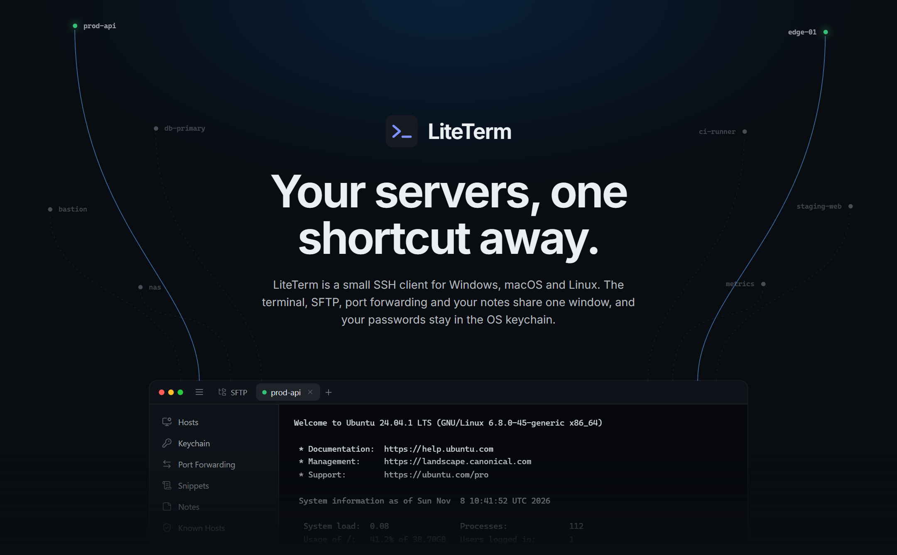
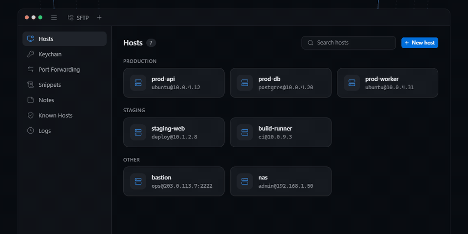
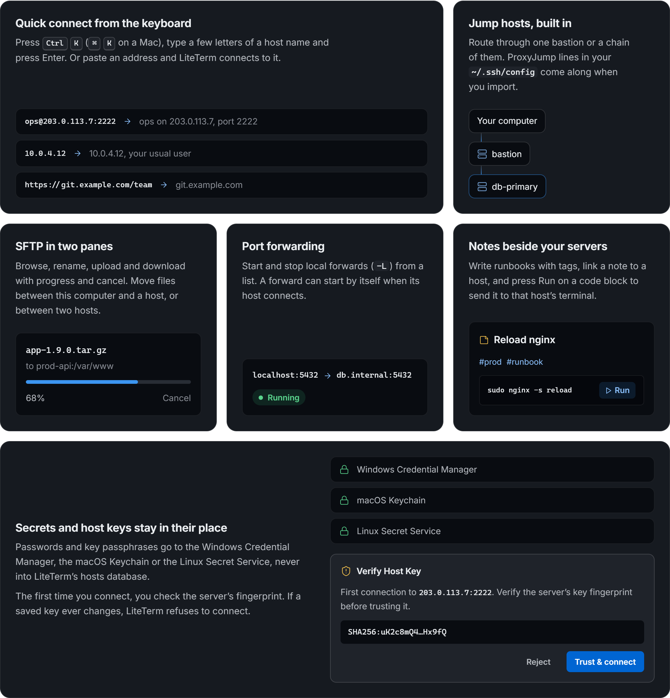
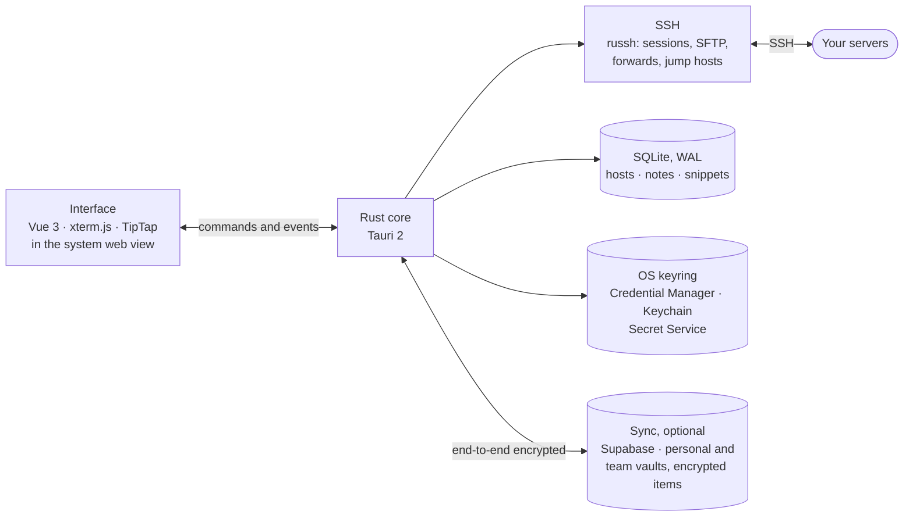

<div align="center">



<br><br>

[](https://github.com/adittanu/liteterm/releases/latest)

<br>


### [Download](https://github.com/adittanu/liteterm/releases/latest) · [Website](https://liteterm.kreat.id/) · [Features](#features) · [Limits](#what-it-doesnt-do-yet) · [Development](#development)

</div>

<br>

<p align="center">
  
</p>
<p align="center"><sub>Quick connect in one gesture: <kbd>Ctrl</kbd> <kbd>K</kbd>, a few letters, <kbd>Enter</kbd>. An illustration built from the app's own design tokens.</sub></p>

<br>

## Download

<table>
  <tr>
    <th></th>
    <th>Windows</th>
    <th>macOS</th>
    <th>Linux</th>
  </tr>
  <tr>
    <td><b>Package</b></td>
    <td><code>.exe</code> installer, x64</td>
    <td><code>.dmg</code>, universal (Apple Silicon and Intel)</td>
    <td><code>.AppImage</code>, <code>.deb</code>, <code>.rpm</code></td>
  </tr>
  <tr>
    <td><b>Needs</b></td>
    <td>Windows 10 or later</td>
    <td>macOS 11 or later</td>
    <td>WebKitGTK 4.1, such as Ubuntu 22.04 or later</td>
  </tr>
  <tr>
    <td><b>Passwords</b></td>
    <td>Windows Credential Manager</td>
    <td>macOS Keychain</td>
    <td>Secret Service (GNOME Keyring, KWallet)</td>
  </tr>
  <tr>
    <td><b>Updates</b></td>
    <td>Installs itself from inside the app</td>
    <td>Installs itself from inside the app</td>
    <td>Installs itself: the AppImage in place, a <code>.deb</code> or <code>.rpm</code> after your password</td>
  </tr>
  <tr>
    <td><b>Status</b></td>
    <td>Stable</td>
    <td>Beta</td>
    <td>Beta</td>
  </tr>
</table>

**[Get the latest release →](https://github.com/adittanu/liteterm/releases/latest)**

> [!NOTE]
> **macOS:** the app is not signed or notarized yet, so macOS refuses it the first time. Open **System Settings → Privacy & Security** and choose **Open Anyway**, or run `xattr -dr com.apple.quarantine /Applications/LiteTerm.app`.
>
> **Linux:** saving passwords needs a running, unlocked Secret Service such as GNOME Keyring or KWallet. Without one, LiteTerm tells you the password was not saved.

<br>

## Features



<table>
  <tr>
    <td valign="top" width="33%">

**Connect**

- **Quick connect** with <kbd>Ctrl</kbd> <kbd>K</kbd> (<kbd>⌘</kbd> <kbd>K</kbd> on a Mac). Type a host name, or paste `user@host:port`, an IP, a URL or a whole `ssh` command (`-p`, `-l`, `-i`, `-J`). An address on the clipboard is offered, and a typo gets a "did you mean" from your saved hosts.
- **Hosts** in groups, with search.
- **Sign in** with a password, a private key (Ed25519, ECDSA, RSA) or an **SSH agent**: the OpenSSH agent, 1Password, Bitwarden or KeePassXC.
- **Jump hosts** (ProxyJump), chained through as many bastions as you need.
- **Host keys** checked on first use, for every hop. A key that changes is a hard stop.
- **Keys**: generate an Ed25519 key, then install it on a host in one step (like `ssh-copy-id`) and switch the host to log in with it.
- **Startup command** per host, typed after every login and reconnect.

</td>
    <td valign="top" width="33%">

**Work**

- **Terminal** tabs on xterm.js, with find (match case, regex) on <kbd>Ctrl</kbd> <kbd>Shift</kbd> <kbd>F</kbd>.
- **Split a tab** into two panes: right with <kbd>Ctrl</kbd> <kbd>Shift</kbd> <kbd>D</kbd>, down with <kbd>Ctrl</kbd> <kbd>Shift</kbd> <kbd>E</kbd>.
- **Suggestions** in grey from the host's own shell history; <kbd>→</kbd> takes one.
- **Notices** when a long command finishes or a program rings the bell in a tab you aren't looking at, and the computer stays awake while a command runs.
- **Paste a screenshot**: it goes to the server's `/tmp` and its path is pasted, for agent CLIs such as opencode.
- **Auto-reconnect** after a Wi-Fi switch or a sleeping laptop, in the same tab, scrollback kept.
- **SFTP** in two panes: this computer and a host, or two hosts. Files or whole folders, with progress and cancel.
- **Port forwarding**: local (`-L`), remote (`-R`) and a SOCKS proxy (`-D`), started from a list or with their host.
- **Agent forwarding** (`-A`) per host, off until you turn it on: `git pull` on the server signs with the keys in your agent.
- **SSH certificates**: a `-cert.pub` next to the private key (as `ssh-keygen -s` writes it) is offered first, for servers that trust a CA, and so is a certificate held in the SSH agent (`step ssh login`, `tsh login`).
- **Telnet and serial consoles** as hosts too, for switches, routers and boards: pick the protocol, then a port and baud rate for serial (8N1, no flow control).
- **Snippets**: run in one click, or Shift+click to insert. `{{name}}` placeholders are asked for first.
- **Local terminal** next to your sessions.

</td>
    <td valign="top" width="33%">

**Keep**

- **Notes** with `#tags`, linked to a host. A code block's **Run** sends it to that host's terminal.
- **Passwords** in the OS keychain, never in LiteTerm's database.
- **Sync** between your computers, if you sign in: end-to-end encrypted with a master password the server never sees.
- **Team vaults**, free: share hosts, groups, credentials, snippets, notes and port forwards with a team, encrypted on each member's computer. See [Team vaults](#team-vaults).
- **Keys stored in LiteTerm**: a credential can carry its private key, so it signs in on every computer, and for every teammate, without copying a key file.
- **Import** from `~/.ssh/config` and `known_hosts`, or a Termius export. Export and import LiteTerm's own file.
- **Privacy mode** swaps host names and addresses for stand-ins, so screenshots are safe to share.
- **Shortcuts** you can rebind.
- **Light and dark** themes, and nine terminal themes.

</td>
  </tr>
</table>

<br>

## Team vaults

A team vault holds hosts, groups, credentials, snippets, notes and port forwards that every member gets, next to their own. It is free, and it needs sync with a master password.

1. **Create** a team under Settings, Teams, then invite people by email. No email is sent: tell them to open Settings, Teams in LiteTerm, signed in with that address.
2. **They accept**, and their LiteTerm shows a 20-digit **safety code** made from their account's public key.
3. **You admit them** after they read you that code and it matches the one LiteTerm shows you for their invite. The team key is then sealed to the key you checked, so a server that swapped in another key would get nothing.
4. **Use it**: each team gets its own section in Hosts. Make new items there, or move a host, a group or a snippet in from its menu. Its credential and port forwards come along, and its saved passwords become readable to the team.

| Role | Can |
|:--|:--|
| Viewer | Connect, open SFTP and forwards, read notes. Change nothing. |
| Editor | Also add, change and delete items. |
| Admin | Also invite, admit and remove editors and viewers, and rename the team. |
| Owner | Also invite and remove admins, change roles and delete the team. A team keeps at least one owner. |

**What the server sees.** Team names, members' email addresses and roles, invites, public keys, the team key sealed to each member, and the items as encrypted blobs with their ids, sizes and times. It can't read the items, their passwords or their keys.

**When someone leaves** or is removed, LiteTerm makes a new team key, re-encrypts the team's items with it and seals it to the members who stay. Their computers delete the team's items on the next sync. What they already saw can't be taken back, so whoever removes them gets a list of the team's saved passwords, to change on the servers.

**Key files** can't be shared as paths, so a team credential that signs in with a key carries the key itself: choose the file, and LiteTerm reads it once, unlocks it with its passphrase and stores it in the vault. Personal credentials can do the same with **Store the key in LiteTerm**. On each computer the key sits in LiteTerm's database, encrypted with a key kept in the OS keychain.

A team holds up to 50 members and 5,000 items, and an account owns up to 20 teams.

<br>

## How it is built

One small native app: a Rust core and the web view your system already has, so there is no browser to bundle. The Windows installer is about 4 MB.



<br>

## What it doesn't do yet

Better to read this before you install than to find out after.

| | |
|:--|:--|
| **Interrupted transfers start over** | SFTP does not resume a file or folder transfer that broke off. |
| **Mac updates need the Applications folder** | Started from the disk image, or straight from Downloads, LiteTerm can't replace itself and opens the release page instead. |
| **No Pageant** | PuTTY's agent isn't read. The OpenSSH agent, 1Password, Bitwarden and KeePassXC all work, for signing in and for agent forwarding. |
| **FIDO2 security keys are untried** | `ed25519-sk` and `ecdsa-sk` keys (YubiKey and the like) held in an SSH agent are offered, after the keys that need no touch, but this hasn't been tested with a hardware key yet. A security-key file can't be used directly: load it with `ssh-add` first. |
| **Jump hosts need a saved login** | A password with Remember, a key or an agent. |
| **Sync carries key paths, not key files** | A synced host, or a credential that uses a key file, remembers where the key is: copy it to the same place, store the key in LiteTerm (credentials only), or use an SSH agent. Images in notes don't sync yet. |
| **A stored key has no certificate** | A `-cert.pub` is found next to a key file only. For a certificate, use the key file or the SSH agent. |
| **Teams need 1.14** | Older versions keep syncing the personal vault and never see team items. |
| **Resetting the vault everywhere ends teams for that account** | Your team keys open with an account key kept in your vault. If you reset the vault while no computer of yours still holds that key, LiteTerm can't open any team vault on that account again, new ones included. Reset on one computer while another stays signed in, and that one carries the key over. |
| **Older versions see every forward as local** | LiteTerm 1.11 and earlier don't know remote and SOCKS forwards. Synced to such a computer, those run there as local forwards. Update every computer that syncs. |
| **Telnet and serial hosts need 1.13** | Older versions treat them as SSH hosts and fail to connect. Serial lines are fixed at 8N1 without flow control, and Telnet has no local echo for servers that expect one. |
| **macOS and Linux are new** | Those builds come from CI and have had far less testing than Windows. |

<br>

## Development

### Prerequisites

- [Node.js](https://nodejs.org) 22 or later and [pnpm](https://pnpm.io) 10
- [Rust](https://rustup.rs), stable
- The [Tauri 2 prerequisites](https://v2.tauri.app/start/prerequisites/) for your system. On Linux that is:

  ```bash
  sudo apt-get install libwebkit2gtk-4.1-dev libayatana-appindicator3-dev librsvg2-dev \
    patchelf libxdo-dev libssl-dev libdbus-1-dev pkg-config
  ```

### Run

```bash
pnpm install
pnpm tauri dev
```

### Check

```bash
pnpm build                      # type-checks (vue-tsc) and builds the frontend
cd src-tauri && cargo test      # Rust tests
```

### Release

Bump the version in `package.json`, `src-tauri/Cargo.toml` and `src-tauri/tauri.conf.json`, then push a tag that matches it:

```bash
git tag v1.9.0 && git push origin v1.9.0
```

[`.github/workflows/release.yml`](.github/workflows/release.yml) builds Windows, macOS and Linux into a draft release and publishes it once the builds are in. Run the workflow by hand to try a branch: it builds everything and keeps the installers as artifacts, without releasing. With the Apple Developer secrets listed in that file, macOS builds are signed and notarized.

### When the installed app misbehaves

The installed build has no console, so LiteTerm writes panics and errors that would otherwise go unseen to a log next to its database:

| OS | Log |
|:--|:--|
| Windows | `%APPDATA%\com.liteterm.app\liteterm.log` |
| macOS | `~/Library/Application Support/com.liteterm.app/liteterm.log` |
| Linux | `~/.local/share/com.liteterm.app/liteterm.log` |

To get DevTools (<kbd>F12</kbd>) in a release build, build the diagnostic installer with `pnpm tauri build --features diag`. To compare dev with the installer fairly, build with `pnpm tauri build --no-bundle` and start `src-tauri/target/release/liteterm` from the file manager, not a terminal, so it gets the same environment as an installed app.

### Project layout

```
src/                     Vue 3 frontend: views, components, stores, design tokens
src-tauri/src/ssh/       russh client, session pool, SFTP, port forwarding
src-tauri/src/store/     SQLite (migrations and queries), keyring helpers, vaults and stored keys
src-tauri/src/cloud/     optional sync: vault and team encryption, Supabase client, sync loop
supabase/migrations/     the sync server's schema and access rules
supabase/tests/          the server's team vault rules, tried in a rolled-back transaction
src-tauri/src/commands/  Tauri commands
src-tauri/vendor/        portable-pty fork (ConPTY passthrough)
site/                    the landing page (Astro), deployed to GitHub Pages
docs/readme/             the images in this README
```

<br>

## Thanks

Built on [Tauri](https://tauri.app), [russh](https://github.com/Eugeny/russh), [xterm.js](https://xtermjs.org), [TipTap](https://tiptap.dev) and [Lucide](https://lucide.dev). The animated illustrations on the website and in this README were built with the Stageshow kit (MIT).

<br>

## License

LiteTerm is released under the [MIT License](LICENSE). The vendored `portable-pty` fork in `src-tauri/vendor/` keeps its own license.

<sub>Termius, Windows, macOS and Linux are trademarks of their respective owners. LiteTerm is not affiliated with or endorsed by them.</sub>
